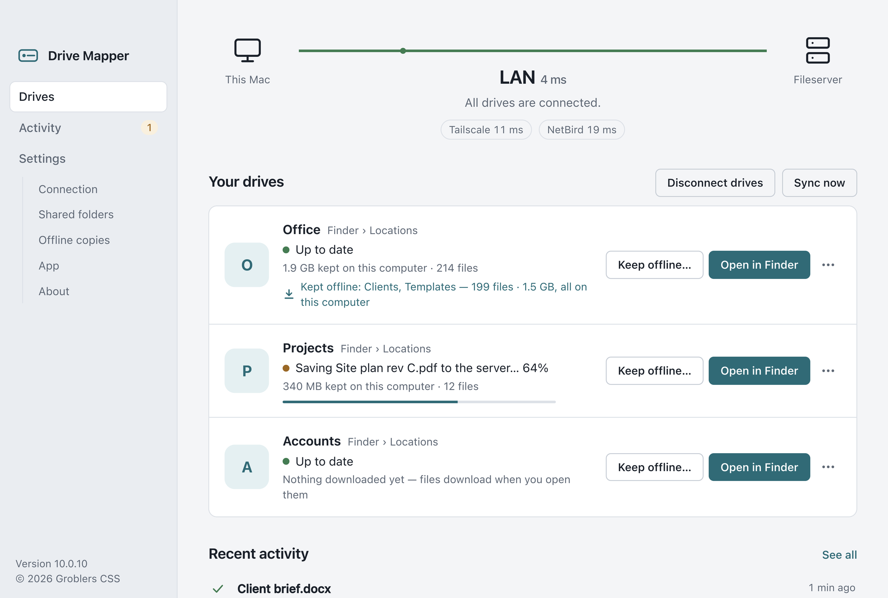
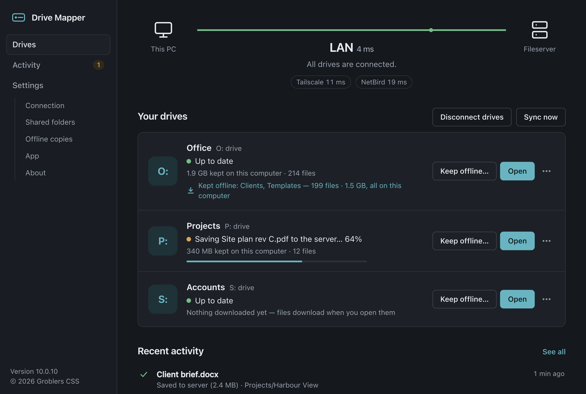
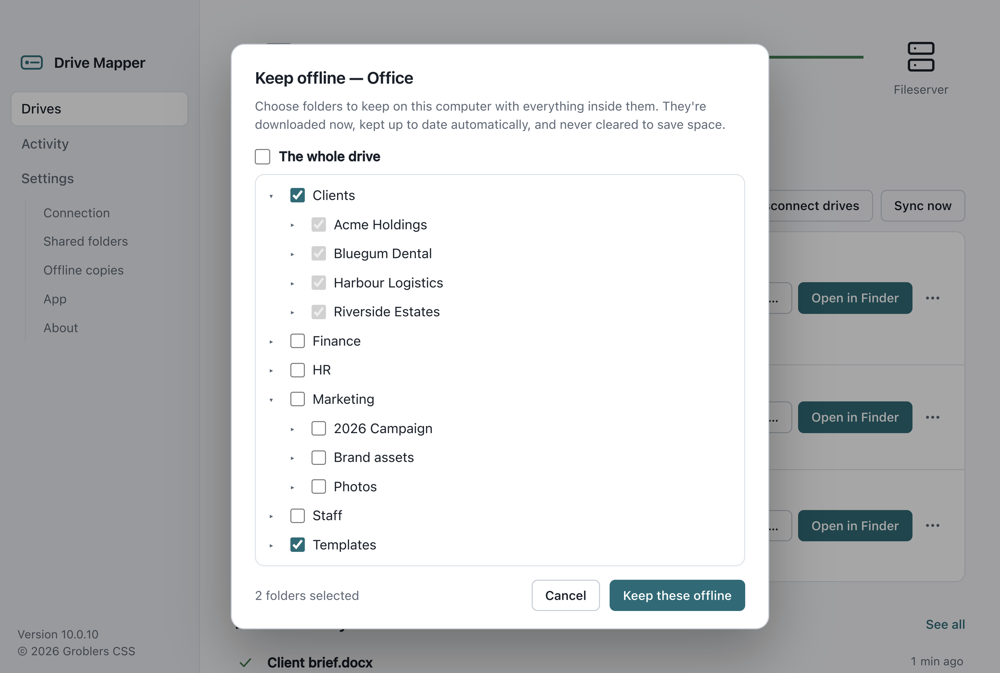
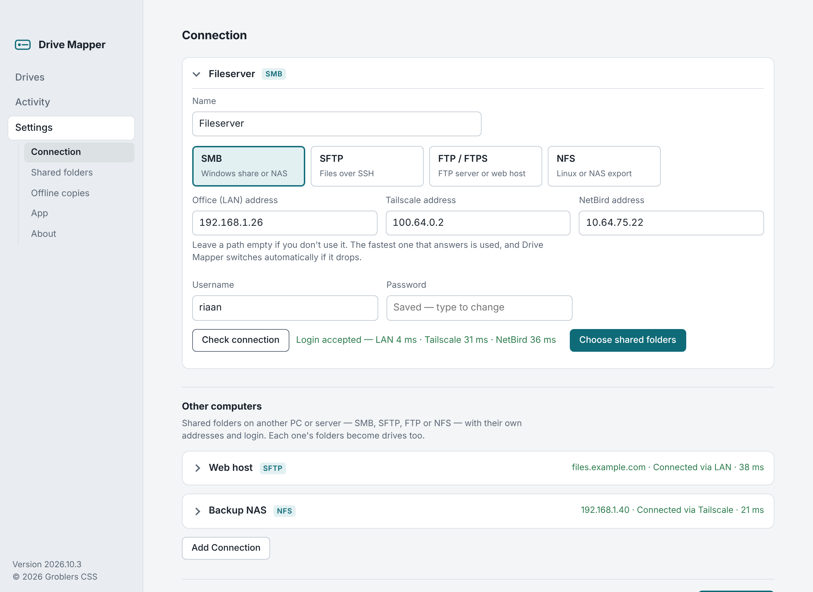
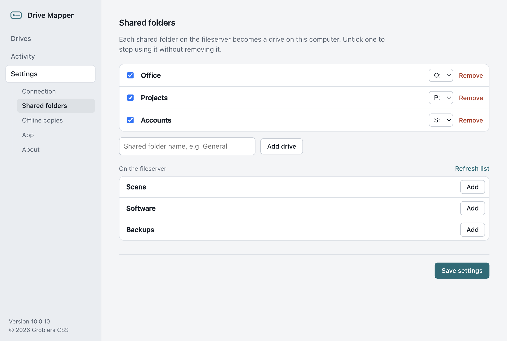
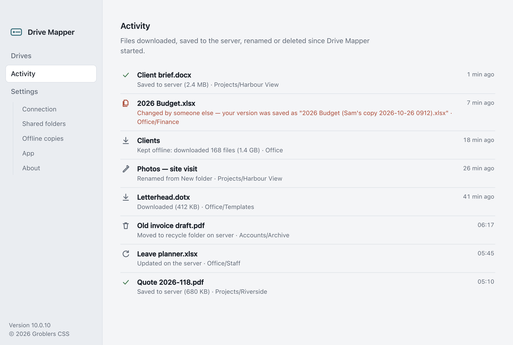

<p align="center"></p>

<h1 align="center">Drive Mapper</h1>

<p align="center">Your fileserver as a drive in <b>Explorer</b> and <b>Finder</b> — over <b>SMB, SFTP, FTP/FTPS or NFS</b>. Files download when you open them, work offline, and every change goes back to the server.</p>

<p align="center">
  <a href="https://buymeacoffee.com/hybridrcg"></a>
</p>

<p align="center"></p>

## Download

Always the newest version:

| | |
|---|---|
| **Windows 10/11** | [Drive-Mapper-Windows-Setup.exe](https://github.com/HybridRCG/DriveMapper/releases/latest/download/Drive-Mapper-Windows-Setup.exe) |
| **Mac — Apple silicon (M1–M4)** | [Drive-Mapper-Mac-Apple-Silicon.dmg](https://github.com/HybridRCG/DriveMapper/releases/latest/download/Drive-Mapper-Mac-Apple-Silicon.dmg) |
| **Mac — Intel** | [Drive-Mapper-Mac-Intel.dmg](https://github.com/HybridRCG/DriveMapper/releases/latest/download/Drive-Mapper-Mac-Intel.dmg) |

Installed copies update themselves. Older versions and change notes are under [Releases](https://github.com/HybridRCG/DriveMapper/releases).

## What it does

- **Shares appear as drives** — a drive letter in Explorer, a volume under Locations in Finder. Browse, open, save, copy, rename and delete as usual.
- **Download on open** — browsing shows every file without downloading anything; a file is fetched the first time you open it.
- **Offline copies** — opened files stay on the computer (7 days after last use by default) so they open instantly and work without a connection.
- **Keep offline** *(licence)* — choose folders to keep on the computer in full, kept up to date automatically.
- **Every change goes back** — saves, new files and folders, renames and deletes reach the server within seconds; changes made offline are sent when the server is back.
- **Never overwrites someone else's work** — if a file changed on the server while you were editing it, your version is saved next to it as *"Name (Riaan's copy …)"*.
- **Deletes are recoverable** — deleted files go to a recycle folder on the share (optional).
- **SMB, SFTP, FTP/FTPS or NFS** — a Windows share or NAS, a Linux server over SSH, an FTP server or web host, or an NFS export. Pick the type and Drive Mapper asks only what that type needs (password or SSH key file, FTPS encryption, NFS version). Mix types freely: each connection's folders become drives.
- **Safe connections** — SSH host keys and self-signed FTPS certificates are remembered the first time and checked every time after, so you'll know if a server is ever swapped out.
- **Office, home or on the road** — connects over the office LAN, Tailscale or NetBird, whichever works best, and switches automatically when one drops.

## Screenshots

<table>
<tr>
<td width="50%"><br><sub><b>Windows</b> — each share is a drive letter. Dark mode follows the system.</sub></td>
<td width="50%"><br><sub><b>Keep offline</b> — tick folders to keep on the computer and in sync.</sub></td>
</tr>
<tr>
<td><br><sub><b>Connection</b> — SMB, SFTP, FTP or NFS over office LAN, Tailscale or NetBird; the fastest path wins. Each connection folds away to one status line.</sub></td>
<td><br><sub><b>Shared folders</b> — pick shares from the server and choose drive letters.</sub></td>
</tr>
<tr>
<td colspan="2"><br><sub><b>Activity</b> — every download, save, rename and delete, including when a colleague changed a file you were editing and your version was saved as a copy.</sub></td>
</tr>
</table>

<sub>Screenshots use made-up example data.</sub>

## Free and supporter versions

Drive Mapper is **free for one drive**. A **[supporter licence ($5)](https://buymeacoffee.com/hybridrcg/e/591363)** unlocks **unlimited drives** and **Keep offline folders** on up to **5 computers**, and removes the reminders. The key arrives by email — paste it under **Settings › About**. See and manage the computers on your key at [zaaz.co.za/drivemapper](https://zaaz.co.za/drivemapper/).

## Installing

**Windows** — run the installer.

**Mac** — open the `.dmg`, drag **Drive Mapper** to **Applications**, then once in Terminal:

```sh
xattr -cr "/Applications/Drive Mapper.app"
```

(The app is not signed with an Apple Developer certificate, so macOS needs this once. Updates take care of it themselves.)

Then open Drive Mapper, choose the connection type (SMB, SFTP, FTP or NFS) and enter the address and login under **Settings › Connection** — use **Add Connection** for more servers — and add your drives under **Settings › Shared folders**.

**NFS on Windows** needs *Client for NFS* (Windows Pro or Enterprise: *Turn Windows features on or off › Services for NFS*).

## Roadmap

Things still to do:

- [ ] **Android app**: browse your Drive Mapper shares from an Android phone or tablet, open files on demand and keep chosen folders offline.
- [ ] **iPhone app**: the same for iPhone and iPad, with the shares in the Files app.

## Support

Questions and licensing: Riaan Grobler, Groblers CSS.
If Drive Mapper saves you time, [buy me a coffee](https://buymeacoffee.com/hybridrcg) ☕

## Licence

Drive Mapper © 2026 Riaan Grobler, trading as Groblers CSS. All rights reserved.
The installers are free to download; use is subject to the [licence notice](LICENSE). The source code is not public.
