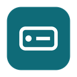

<p align="center"></p>

<h1 align="center">Drive Mapper</h1>

<p align="center">Your fileserver as a drive in <b>Explorer</b> and <b>Finder</b> — files download when you open them, work offline, and every change goes back to the server.</p>

<p align="center">
  <a href="https://buymeacoffee.com/hybridrcg"></a>
</p>

## Download

Always the newest version:

| | |
|---|---|
| **Windows 10/11** | [Drive-Mapper-Windows-Setup.exe](https://github.com/HybridRCG/DriveMapper/releases/latest/download/Drive-Mapper-Windows-Setup.exe) |
| **Mac — Apple silicon (M1–M4)** | [Drive-Mapper-Mac-Apple-Silicon.dmg](https://github.com/HybridRCG/DriveMapper/releases/latest/download/Drive-Mapper-Mac-Apple-Silicon.dmg) |
| **Mac — Intel** | [Drive-Mapper-Mac-Intel.dmg](https://github.com/HybridRCG/DriveMapper/releases/latest/download/Drive-Mapper-Mac-Intel.dmg) |

Installed copies update themselves. Older versions and change notes are under [Releases](https://github.com/HybridRCG/DriveMapper/releases).

## What it does

- **Shares appear as drives** — a drive letter in Explorer, a volume under Locations in Finder. Browse, open, save, copy, rename and delete as usual.
- **Download on open** — browsing shows every file without downloading anything; a file is fetched the first time you open it.
- **Offline copies** — opened files stay on the computer (7 days after last use by default) so they open instantly and work without a connection.
- **Keep offline** — choose folders to keep on the computer in full, kept up to date automatically.
- **Every change goes back** — saves, new files and folders, renames and deletes reach the server within seconds; changes made offline are sent when the server is back.
- **Never overwrites someone else's work** — if a file changed on the server while you were editing it, your version is saved next to it as *"Name (Riaan's copy …)"*.
- **Deletes are recoverable** — deleted files go to a recycle folder on the share (optional).
- **Office, home or on the road** — connects over the office LAN, Tailscale or NetBird, whichever works best, and switches automatically when one drops.

## Installing

**Windows** — run the installer.

**Mac** — open the `.dmg`, drag **Drive Mapper** to **Applications**, then once in Terminal:

```sh
xattr -cr "/Applications/Drive Mapper.app"
```

(The app is not signed with an Apple Developer certificate, so macOS needs this once. Updates take care of it themselves.)

Then open Drive Mapper, enter the fileserver address and login under **Settings › Connection**, and add your drives under **Settings › Shared folders**.

## Support

Questions and licensing: Riaan Grobler, Groblers CSS.
If Drive Mapper saves you time, [buy me a coffee](https://buymeacoffee.com/hybridrcg) ☕

## Licence

Drive Mapper © 2026 Riaan Grobler, trading as Groblers CSS. All rights reserved.
The installers are free to download; use is subject to the [licence notice](LICENSE). The source code is not public.
